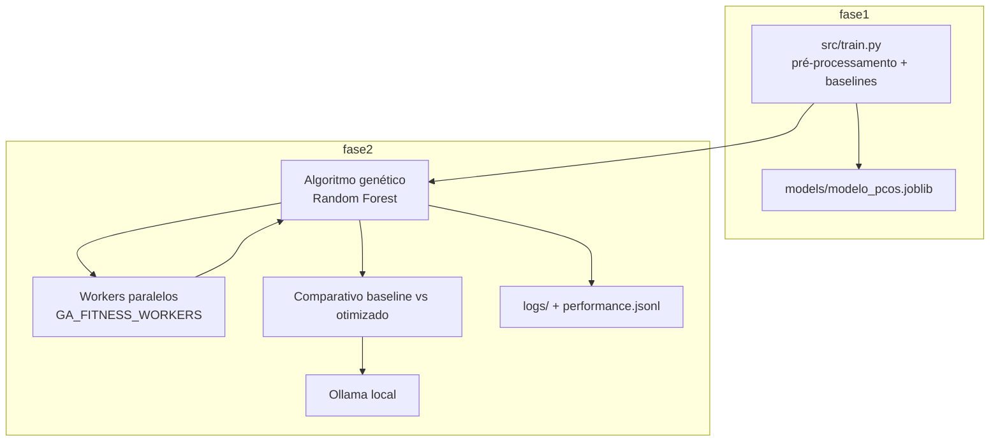

# Fase 2 — Arquitetura (continuação do projeto PCOS)

- **Dados e split**: `load_data()` e `get_train_test_split()` — mesmo `random_state=42` da Fase 1.
- **Fitness**: validação cruzada 3-fold **somente no treino**; score composto 50% recall + 30% F1 + 20% ROC-AUC (critério clínico da Fase 1).
- **Comparativo final**: métricas no **teste 20%** entre `BASELINE_RF_HYPERPARAMS` e melhor genoma do AG.
- **LLM**: explicações e relatório em português; prompts em `src/phase2/llm/prompts.py`.
- **Escalabilidade**: cada geração do AG enfileira indivíduos avaliados em paralelo via `src/phase2/scaling/executor.py` (`ThreadPoolExecutor`). Ajuste `GA_FITNESS_WORKERS` no `.env`. Demo: `python scripts/benchmark_scaling.py`. Evolução em nuvem: mesma fila com autoscaler sobre workers (documentado no relatório).
