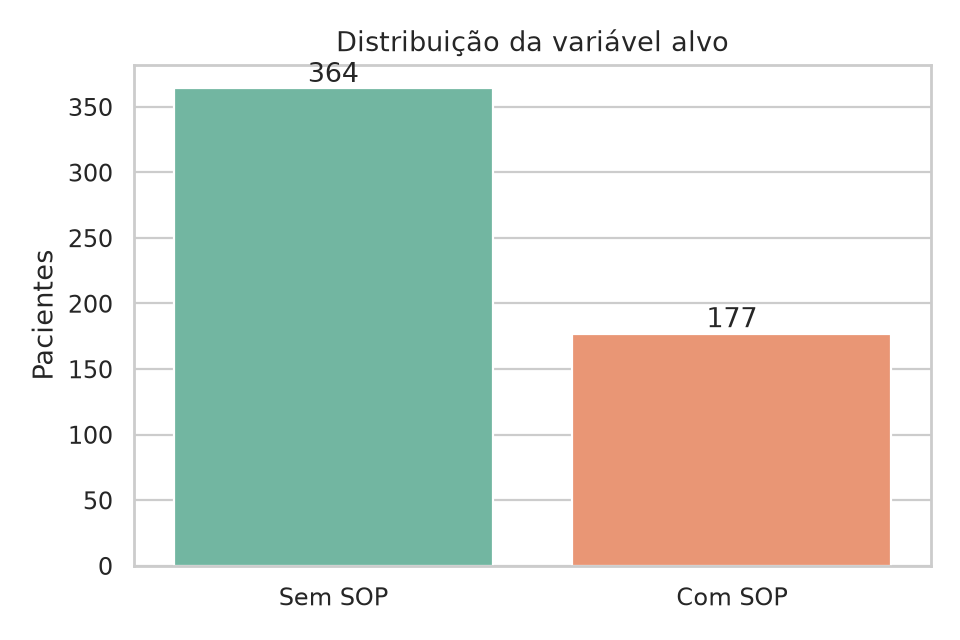
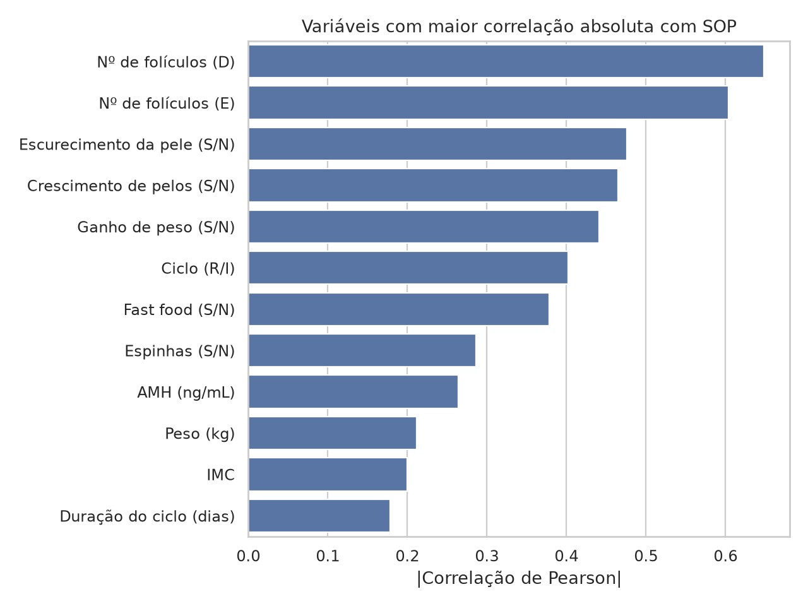
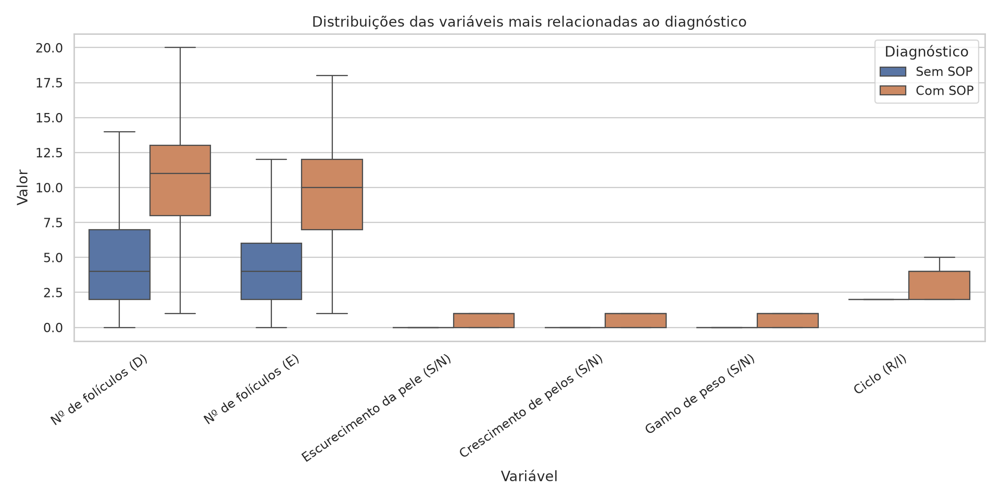
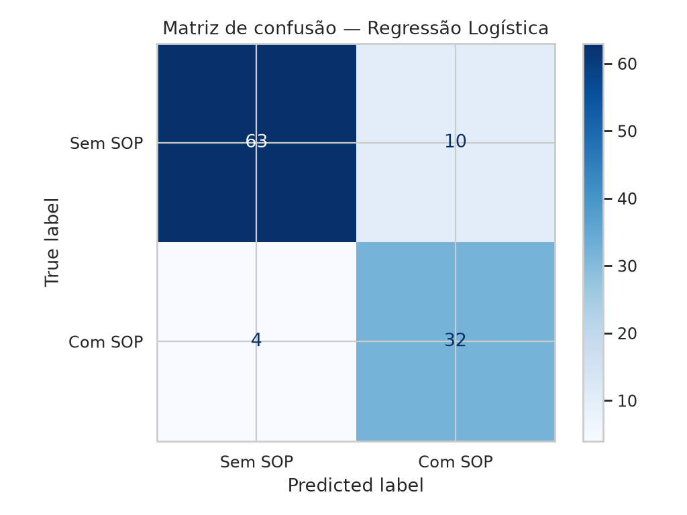
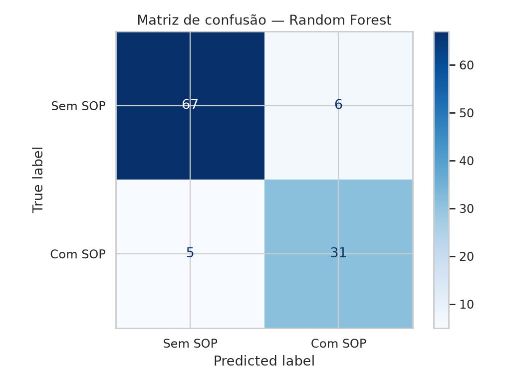
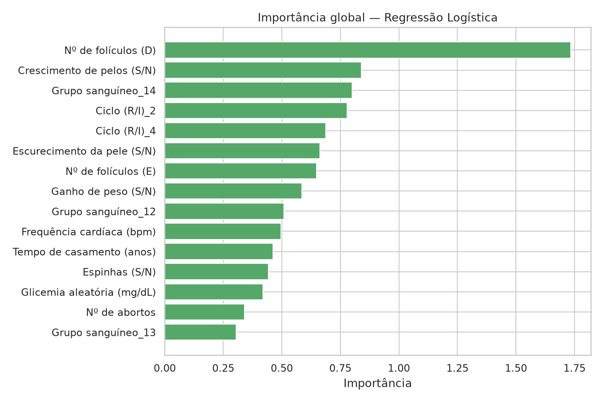
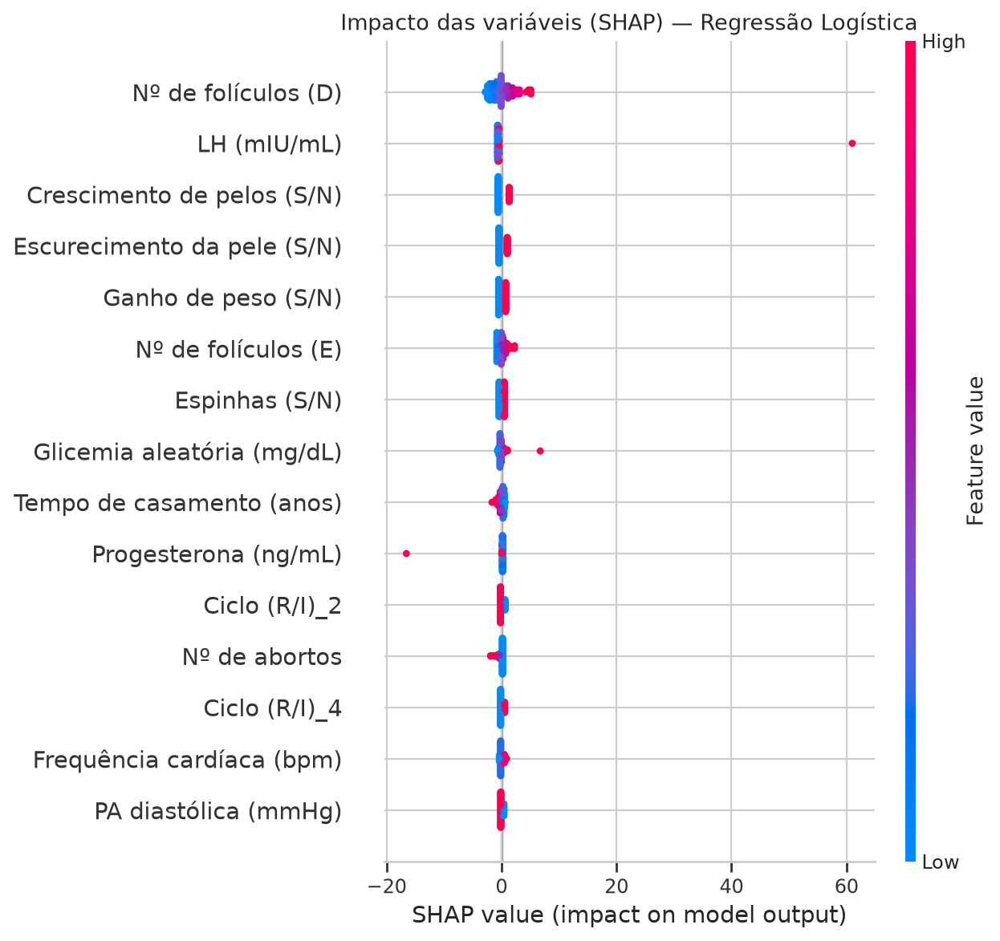
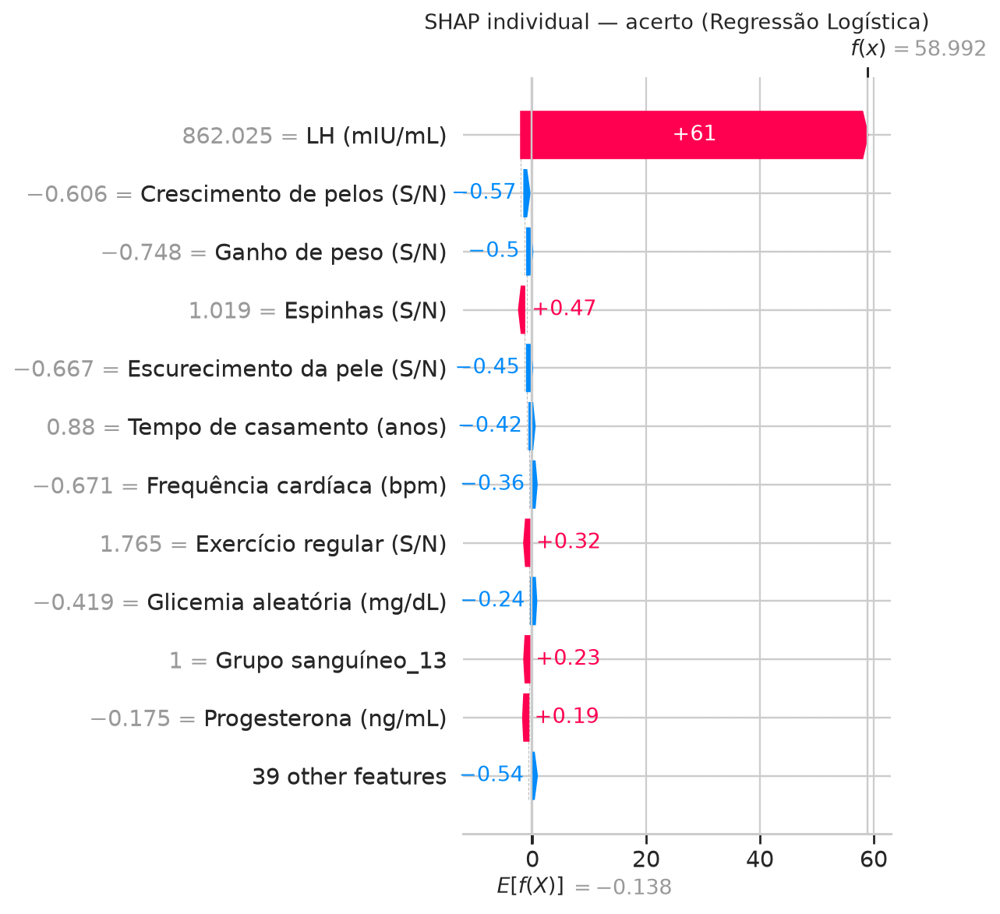
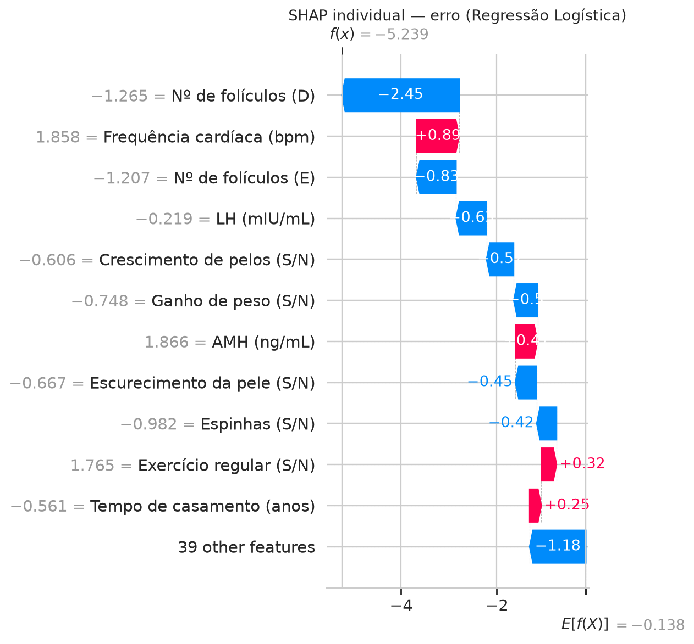

# Relatório técnico — Classificação de Síndrome dos Ovários Policísticos

## Identificação

- Instituição: Fiap
- Curso: IA para DEVs
- Fase: 1
- Integrante: Brenda Reis - RM376294
- Repositório: https://github.com/brenda-guinarte/pos-fiap-ia-para-devs
- Vídeo: https://youtu.be/rRfgysj36dU
- Data: 29/08/2026

## 1. Introdução

A Síndrome dos Ovários Policísticos (SOP ou PCOS) é uma condição hormonal
associada a alterações do ciclo menstrual, sinais de hiperandrogenismo,
fertilidade e riscos metabólicos. Este projeto investiga o uso de aprendizado de
máquina como apoio à triagem, classificando pacientes em “com SOP” ou “sem
SOP” a partir de parâmetros clínicos estruturados.

O objetivo não é substituir a avaliação profissional. O sistema proposto deve
funcionar como um sinalizador de risco para apoiar a priorização de pacientes,
mantendo a decisão diagnóstica com a equipe médica.

## 2. Dados

Foi utilizado o dataset público
[Polycystic ovary syndrome (PCOS)](https://www.kaggle.com/datasets/prasoonkottarathil/polycystic-ovary-syndrome-pcos),
publicado por Prasoon Kottarathil em 2020. A base reúne parâmetros físicos e
clínicos de 541 pacientes atendidas em dez hospitais de Kerala, Índia.

A variável alvo é `SOP (S/N)`, codificada como 0 para ausência e 1 para
presença de SOP. Identificadores administrativos foram removidos por não terem
significado preditivo e poderem introduzir relações artificiais. As demais
colunas clínicas foram traduzidas para português no pipeline de carregamento.

## 3. Análise exploratória

A exploração verificou dimensões, tipos, estatísticas descritivas, valores
ausentes, duplicidades, distribuição da classe alvo e relação das variáveis com
o diagnóstico.

As correlações são descritivas e não implicam causalidade. Variáveis com maior
associação podem refletir critérios já usados na investigação da SOP. Essa
característica favorece a predição no contexto do dataset, mas exige cautela ao
definir o momento clínico em que o modelo seria utilizado.

Das 541 pacientes, 177 pertencem à classe com SOP, correspondendo a 32,7% da
amostra. O desbalanceamento é moderado e foi tratado com estratificação e pesos
de classe, sem criação de observações sintéticas.

As maiores correlações positivas com o alvo foram número de folículos no ovário
direito (0,648), número de folículos no ovário esquerdo (0,603), escurecimento
da pele (0,476), crescimento de pelos (0,465), ganho de peso (0,441) e
irregularidade do ciclo (0,402). Esses padrões são clinicamente plausíveis:
diretrizes internacionais relacionam o diagnóstico em adultas à disfunção
ovulatória, hiperandrogenismo e morfologia policística dos ovários, depois da
exclusão de outras causas.

Quatro campos possuem apenas um valor ausente cada (0,18%): tempo de casamento,
segundo beta-HCG, AMH e consumo de fast food. A variável AMH também continha uma
entrada textual inválida, convertida em ausente. Uma coluna residual sem
significado clínico, com apenas dois valores espúrios, foi removida.

## 4. Pré-processamento

Foram aplicadas as seguintes etapas:

1. Remoção de número sequencial, número de prontuário e coluna residual.
2. Conversão de campos clínicos para formato numérico, transformando entradas
   inválidas em ausentes.
3. Imputação pela mediana nas variáveis numéricas.
4. Imputação pela moda e One-Hot Encoding nas categorias codificadas de grupo
   sanguíneo e regularidade do ciclo.
5. Padronização das variáveis numéricas.

As transformações foram encapsuladas em um `ColumnTransformer` dentro de cada
pipeline. Elas são ajustadas somente com o conjunto de treino, evitando
vazamento de informações do teste.

## 5. Estratégia de modelagem

Foi realizada separação estratificada de 80% para treino e 20% para teste com
semente fixa 42. No treino, foi aplicada validação cruzada estratificada com
cinco folds.

Dois modelos foram comparados:

- **Regressão Logística:** baseline linear, eficiente e interpretável por
  coeficientes.
- **Random Forest:** conjunto de árvores capaz de aprender interações e relações
  não lineares, com importância de variáveis disponível.

Os dois modelos utilizam pesos balanceados para reduzir o impacto da diferença
entre as classes.

## 6. Métricas e critério de escolha

Foram avaliadas accuracy, precisão, recall, F1 e ROC-AUC. A principal métrica
foi o **recall da classe positiva**, pois um falso negativo pode atrasar a
investigação de uma paciente com possível SOP. O F1 complementa a análise ao
equilibrar recall e precisão, enquanto ROC-AUC mede a capacidade geral de
separação entre as classes.

| Modelo | Accuracy | Precisão | Recall | F1 | ROC-AUC |
|---|---:|---:|---:|---:|---:|
| Regressão Logística | 0,872 | 0,762 | **0,889** | 0,821 | **0,951** |
| Random Forest | **0,899** | **0,838** | 0,861 | **0,849** | 0,941 |

Pelo critério definido previamente, a Regressão Logística foi selecionada por
obter o maior recall no conjunto de teste. Embora a Random Forest apresente
melhores accuracy, precisão e F1, o modelo linear deixou de identificar menos
casos positivos nesta divisão.

## 7. Explicabilidade

A importância global permite observar quais variáveis mais influenciam o
modelo. Valores altos de importância indicam contribuição preditiva, não uma
relação causal.

O SHAP mostra direção e intensidade da contribuição das variáveis em diferentes
pacientes. Pontos à direita aumentam a saída do modelo; pontos à esquerda a
reduzem. A interpretação deve considerar o significado clínico e a forma como
as variáveis foram transformadas.

No modelo selecionado, as maiores magnitudes globais ocorreram para número de
folículos no ovário direito, crescimento de pelos, categorias de grupo
sanguíneo, regularidade do ciclo, escurecimento da pele, número de folículos no
ovário esquerdo e ganho de peso. Folículos, irregularidade menstrual e sinais
de hiperandrogenismo são coerentes com os critérios diagnósticos descritos pela
OMS e pela diretriz internacional de 2023. Já a aparente influência de
categorias de grupo sanguíneo não deve ser interpretada como causal: pode ser
instabilidade de uma amostra pequena e deve ser investigada em validação
externa.

Foram selecionados dois casos anônimos no conjunto de teste: a Paciente A,
classificada corretamente, e a Paciente B, com erro de classificação
(preferencialmente falso negativo). Os gráficos waterfall correspondentes
preservam o anonimato e descrevem o comportamento do modelo, não uma
justificativa clínica.

## 8. Discussão crítica

Os resultados sugerem que os dados contêm padrões úteis para classificação,
mas não justificam uso clínico imediato. A base possui apenas 541 registros e
representa hospitais de uma região específica da Índia. Diferenças de
população, protocolo, equipamentos e preenchimento podem reduzir o desempenho
em outro contexto.

Antes de uso prático seriam necessários:

- validação externa, preferencialmente em população brasileira;
- calibração das probabilidades e definição clínica do limiar;
- avaliação de desempenho por faixa etária e outros subgrupos;
- análise de viés, drift e qualidade dos dados;
- integração com fluxo de revisão humana;
- controles de privacidade, segurança e LGPD.

O uso mais apropriado seria como apoio à triagem: pacientes com risco elevado
seriam priorizadas para avaliação, sem produção de diagnóstico automático.

## 9. Conclusão

O projeto demonstrou um fluxo reproduzível de exploração, pré-processamento,
treinamento, avaliação e explicabilidade para classificação de SOP. A Regressão
Logística foi selecionada pelo maior recall, alinhado ao custo de falsos
negativos. Os resultados são promissores no contexto acadêmico, porém dependem
de validação externa e supervisão médica antes de qualquer aplicação real.

## 10. Referências

- KOTTARATHIL, Prasoon. *Polycystic ovary syndrome (PCOS)*. Kaggle, 2020.
  Disponível em:
  https://www.kaggle.com/datasets/prasoonkottarathil/polycystic-ovary-syndrome-pcos
- WORLD HEALTH ORGANIZATION. *Polycystic ovary syndrome*. Disponível em:
  https://www.who.int/news-room/fact-sheets/detail/polycystic-ovary-syndrome
- TEEDE, H. J. et al. Recommendations From the 2023 International
  Evidence-based Guideline for the Assessment and Management of Polycystic
  Ovary Syndrome. *The Journal of Clinical Endocrinology & Metabolism*, v. 108,
  n. 10, p. 2447–2469, 2023. DOI:
  https://doi.org/10.1210/clinem/dgad463
